```mermaid
graph LR
  classDef sys fill:#6a5520,stroke:#ffd700,stroke-width:2px,color:#fff,font-weight:bold;
  subgraph help["帮助工具"]
    help_0["修仙帮助"]
    help_1["解卡"]
  end
  subgraph player["玩家基础"]
    player_2["我要修仙"]
    player_3["我的信息"]
    player_4["弃道重修"]
    player_5["闭关"]
    player_6["出关"]
    player_7["签到"]
    player_8["一键日常"]
  end
  subgraph equip["装备"]
    equip_9["我的装备"]
    equip_10["装备"]
    equip_11["卸下"]
  end
  subgraph breakthrough["修炼突破"]
    breakthrough_12["突破信息"]
    breakthrough_13["突破"]
  end
  subgraph pill["丹药"]
    pill_14["服用丹药"]
    pill_15["丹药背包"]
    pill_16["丹药信息"]
  end
  subgraph shop["商店"]
    shop_17["丹阁"]
    shop_18["器阁"]
    shop_19["百宝阁"]
    shop_20["物品信息"]
    shop_21["购买"]
    shop_22["购买物品"]
  end
  subgraph ring["储物戒"]
    ring_23["储物戒"]
    ring_24["取出"]
    ring_25["更换储物戒"]
    ring_26["丢弃"]
    ring_27["赠予"]
    ring_28["接收"]
    ring_29["拒绝"]
    ring_30["搜索物品"]
    ring_31["取出所有"]
  end
  subgraph sect["宗门"]
    sect_32["创建宗门"]
    sect_33["加入宗门"]
    sect_34["退出宗门"]
    sect_35["我的宗门"]
    sect_36["宗门任务"]
    sect_37["完成宗门任务"]
    sect_38["宗门列表"]
    sect_39["宗门捐献"]
    sect_40["踢出成员"]
    sect_41["宗主传位"]
    sect_42["职位变更"]
    sect_43["大比切磋"]
  end
  subgraph oldboss["旧Boss"]
    oldboss_44["世界Boss"]
    oldboss_45["挑战Boss"]
  end
  subgraph ranking["排行榜"]
    ranking_46["境界排行"]
    ranking_47["战力排行"]
    ranking_48["灵石排行"]
    ranking_49["宗门排行"]
    ranking_50["存款排行"]
    ranking_51["贡献排行"]
  end
  subgraph pvp["战斗PVP"]
    pvp_52["决斗"]
    pvp_53["切磋"]
  end
  subgraph rift["秘境"]
    rift_54["秘境列表"]
    rift_55["探索秘境"]
    rift_56["退出秘境"]
  end
  subgraph adventure["历练"]
    adventure_57["开始历练"]
    adventure_58["历练状态"]
    adventure_59["历练信息"]
  end
  subgraph alchemy["炼丹"]
    alchemy_60["丹药配方"]
    alchemy_61["炼丹"]
  end
  subgraph impart["传承"]
    impart_62["传承信息"]
  end
  subgraph nickname["道号"]
    nickname_63["改道号"]
  end
  subgraph bank["银行"]
    bank_64["银行"]
    bank_65["存灵石"]
    bank_66["取灵石"]
    bank_67["领取利息"]
    bank_68["贷款"]
    bank_69["还款"]
    bank_70["银行流水"]
    bank_71["突破贷款"]
  end
  subgraph bounty["悬赏"]
    bounty_72["悬赏令"]
    bounty_73["接取悬赏"]
    bounty_74["悬赏状态"]
    bounty_75["完成悬赏"]
    bounty_76["放弃悬赏"]
  end
  subgraph impartpk["传承PK"]
    impartpk_77["传承挑战"]
    impartpk_78["传承排行"]
  end
  subgraph land["洞天"]
    land_79["我的洞天"]
    land_80["购买洞天"]
    land_81["升级洞天"]
    land_82["洞天收取"]
    land_83["进阶洞天"]
  end
  subgraph farm["灵田"]
    farm_84["我的灵田"]
    farm_85["开垦灵田"]
    farm_86["种植"]
    farm_87["收获"]
    farm_88["升级灵田"]
  end
  subgraph eye["灵眼"]
    eye_89["灵眼信息"]
    eye_90["抢占灵眼"]
    eye_91["灵眼收取"]
    eye_92["释放灵眼"]
  end
  subgraph dailytask["日常任务"]
    dailytask_93["任务榜"]
    dailytask_94["接取任务"]
    dailytask_95["领取任务奖励"]
  end
  subgraph worldboss["世界Boss"]
    worldboss_96["挑战世界Boss"]
    worldboss_97["世界Boss状态"]
  end
  subgraph robbery["掠夺"]
    robbery_98["开启护府"]
    robbery_99["潜入洞府"]
  end
  subgraph gamble["赌石黑市"]
    gamble_100["切原石"]
    gamble_101["黑市"]
    gamble_102["黑市购买"]
  end
  subgraph forge["炼器"]
    forge_103["强化"]
    forge_104["洗练"]
  end
  subgraph demon["天魔入侵"]
    demon_105["开启天魔入侵"]
    demon_106["查验天魔"]
    demon_107["天魔状态"]
  end
  subgraph pet["灵兽"]
    pet_108["我的灵兽"]
    pet_109["孵化灵兽"]
    pet_110["喂养灵兽"]
    pet_111["放生灵兽"]
    pet_112["吞噬灵兽"]
  end
  subgraph auction["坊市"]
    auction_113["坊市"]
    auction_114["坊市上架"]
    auction_115["坊市购买"]
    auction_116["坊市下架"]
  end
  subgraph spirit["仙灵"]
    spirit_117["仙灵结缘"]
    spirit_118["仙灵共修"]
    spirit_119["仙灵解除"]
    spirit_120["仙灵代收"]
  end
  subgraph mentor["师徒"]
    mentor_121["拜师"]
    mentor_122["出师"]
    mentor_123["逐出师门"]
    mentor_124["师徒"]
    mentor_125["师德兑换"]
  end
  subgraph title["称号图鉴"]
    sys_title["称号图鉴"]
    title_127["佩戴称号"]
    title_128["我的称号"]
  end
  subgraph tide["魔潮天灾"]
    tide_129["开启魔潮"]
    tide_130["魔潮状态"]
    tide_131["抵御魔潮"]
    tide_132["仙界日历"]
  end
  subgraph avatar["化身托管"]
    avatar_133["激活化身"]
  end
  subgraph escort["押镖劫道"]
    escort_134["押镖"]
    escort_135["完成押镖"]
    escort_136["放弃押镖"]
    escort_137["劫镖"]
  end
  subgraph karma["功德因果"]
    karma_138["行善"]
  end
  subgraph admintool["管理工具"]
    admintool_139["仙界管理"]
  end
  subgraph lifeskill["生活职业"]
    lifeskill_140["选择生活职业"]
    lifeskill_141["制符"]
  end
  subgraph encounter["奇遇"]
    encounter_142["奇遇选择"]
  end
  subgraph furnish["洞天装修"]
    furnish_143["洞天装修"]
  end
  subgraph sectbuild["宗门建筑"]
    sectbuild_144["宗门建筑"]
    sectbuild_145["升级建筑"]
  end
  subgraph misc2["其他扩展"]
    misc2_146["完成探索"]
    misc2_147["提前退出"]
    misc2_148["完成历练"]
    misc2_149["双修"]
    misc2_150["接受双修"]
    misc2_151["拒绝双修"]
    misc2_152["飞升"]
    misc2_153["解封传家宝"]
    misc2_154["仙缘商店"]
    misc2_155["仙缘兑换"]
    misc2_156["开启宗门大比"]
    misc2_157["结束宗门大比"]
    misc2_158["施肥"]
    misc2_159["杂交"]
    misc2_160["储物戒附魔"]
    misc2_161["升级丹炉"]
    misc2_162["季节"]
    misc2_163["火候"]
    misc2_164["功德榜"]
    misc2_165["气运榜"]
    misc2_166["师德榜"]
  end
  subgraph equipset["装备图鉴"]
    装备图鉴["装备图鉴"]
  end
  subgraph mailbox["离线信箱"]
    信箱["信箱"]
  end
  subgraph pillparty["宗门丹会"]
    宗门丹会["宗门丹会"]
    领丹会丹["领丹会丹"]
  end
  subgraph xianpu["仙谱"]
    仙谱["仙谱"]
  end
  sys_title{"⚙ 称号图鉴"}:::sys
  sys_encounter{"⚙ 奇遇系统"}:::sys
  sys_advisor{"⚙ 智能提示引擎"}:::sys
  sys_karma{"⚙ 功德因果"}:::sys
  sys_mentor{"⚙ 师徒系统"}:::sys
  sys_spirit{"⚙ 仙灵道侣"}:::sys
  sys_daily{"⚙ 日常任务"}:::sys
  sys_bounty{"⚙ 悬赏系统"}:::sys
  hub_breakthrough -->|境界称号| sys_title
  hub_breakthrough -->|师德+5| sys_mentor
  hub_breakthrough -->|下一步指引| sys_advisor
  player_5 --> sys_advisor
  player_7 --> sys_advisor
  adventure_57 -->|20%触发| sys_encounter
  misc2_148 --> sys_bounty
  misc2_148 --> sys_title
  misc2_146 -->|25%触发| sys_encounter
  misc2_146 --> sys_daily
  shop_21 --> ring_23
  shop_21 --> hub_pill
  escort_135 --> sys_bounty
  escort_135 --> sys_karma
  escort_137 -->|业力| sys_karma
  worldboss_96 --> sys_daily
  worldboss_96 --> sys_title
  tide_131 --> sys_karma
  demon_106 --> sys_title
  spirit_117 --> sys_spirit
  spirit_117 -->|互斥| misc2_149
  spirit_120 --> sys_spirit
  sect_43 --> sys_title
  misc2_152 --> sys_title
  karma_138 --> sys_karma
  alchemy_61 --> sys_title
  alchemy_61 --> sys_advisor
  hub_breakthrough{"修炼突破"}
  hub_pill{"丹药"}
  装备 --> equipset_panel["🎴 套装生效"]
  劫镖 --> mailbox_node["📮 离线信箱"]
  悬赏助力 --> mailbox_node

```

# AstrBot 插件：模拟修仙 v6.21 (万象归一版)

<p align="center">
  
</p>

<h1 align="center">模拟修仙 · 仙缘万象</h1>

<p align="center">
  <a href="https://github.com/iqapi/astrbot_plugin_xiuxian_promax/stargazers">
    
  </a>
  <a href="https://github.com/iqapi/astrbot_plugin_xiuxian_promax/forks">
    
  </a>
  <a href="https://github.com/iqapi/astrbot_plugin_xiuxian_promax/issues">
    
  </a>
  
  
  
</p>

<p align="center">
  <b>⭐ 觉得不错就点个 Star 吧 —— 你的 Star 是我们持续更新的动力！</b><br>
  <picture>
  <source media="(prefers-color-scheme: dark)" srcset="https://raw.githubusercontent.com/iqapi/astrbot_plugin_xiuxian_promax/output/skyline-dark.svg">
  
  </picture>
</p>

---

> **插件版本:** v3.13.3 · **游戏版本:** v6.18 · **数据库:** v29  
> **原作者:** xiaojuwa · **二改:** [Zspor](https://github.com/Zspor/astrbot_plugin_monixiuxian2) · **三改维护:** [云兮](https://github.com/iqapi)

一款为 AstrBot 深度重构的**放置类群聊修仙游戏**。从炼气一层到混元大罗金仙，168+ 条指令、13 个大系统、110 个称号、60 条历练路线、110+ 奇遇事件，与群友一起修仙问道。

---

## ✨ 核心玩法总览

| 系统 | 内容 |
|------|------|
| ⚔️ **七大门派** | 灵修/体修/魔修/剑修/鬼修/佛修/御兽，各带专属倍率 |
| 🗺️ **60条历练路线** | 炼气一层→渡劫期每层都有专属路线，风险收益各异 |
| 🎲 **110+ 奇遇** | Roguelike 三选一事件，善行/恶行影响因果 |
| 🏅 **110 称号图鉴** | 凡/灵/地/天/圣/帝六品阶，最高品阶自动生效加成 |
| 🌗 **五行克制** | 金木水火土相生相克，克制+30% 被克-20% |
| 🌑 **魔潮天灾** | 每周六/月初自动开启，全服捐献抵御，失败全服-20% |
| 💍 **仙灵道侣** | 5位NPC道侣结缘养成，专属被动加成 |
| 🎓 **师徒系统** | 拜师/出师/师德商店，传道真人称号 |
| 🛡️ **押镖劫道** | 高额镖银+功德，全服可劫，公平PVP |
| 🔥 **炼丹火候** | 猛火/文火/守中三选，极品丹双份产出，丹劫机制 |
| 🌾 **灵田四季** | 春夏秋冬轮转影响生长，肥力/杂交玩法 |
| 🏛️ **宗门建筑** | 藏经阁/演武场/炼丹房全宗被动 |
| 💰 **经济体系** | 银行复利/贷款/坊市交易/黑市/赌石/突破资费回收 |
| 🎴 **鎏金卡片** | 12+ 界面磨砂玻璃图片卡，五级字体层次+emoji鎏金 |

---

## 📦 安装

### 1. 环境要求
- AstrBot（建议 v4.x+）
- Python 3.10+

### 2. 安装依赖
```
aiosqlite>=0.19.0
Pillow>=9.0.0
```

### 3. 部署插件
```
将本仓库放入 AstrBot 的 data/plugins/astrbot_plugin_xiuxian_promax
重启 AstrBot 即自动完成初始化与数据库建表（v29）
```

### 4. 配置（WebUI 可视化配置）
- `WHITELIST_GROUPS`：启用插件的群号（**必配，否则全服事件不广播**）
- `BOSS_ADMINS`：管理员 QQ（生成Boss/开启魔潮/仙界管理）
- `IMAGE_CARDS`：12 个图片卡片独立开关
- 其余数值项均有默认值

### 5. 旧版迁移
从 `astrbot_plugin_monixiuxian2` 或 `astrbot_plugin_xiuxian` 升级：首次启动**自动整体迁移数据**，玩家数据无缝保留。

---

## 🚀 快速上手（玩家视角）

```
我要修仙 剑修        ← 创建角色（7职业任选）
签到                 ← 每日福利（节日有大奖）
闭关 → 出关           ← 挂机修炼
开始历练             ← 选择 60 条路线之一
接取任务 玄          ← 今日随机任务
突破                 ← 提升境界（会死的那种）
仙灵结缘 青璃         ← 找位 NPC 道侣陪伴修行
称号图鉴             ← 查看 110 个称号收集进度
修仙帮助             ← 全部 168+ 指令
```

> 💡 所有指令以 `/` 或 `` 开头才会响应。

---

## 🧪 部署前自检（可选）

```
py -3 -X utf8 _final_check.py            # 全局体检（语法/指令覆盖/配置对账）
py -3 -X utf8 tests\test_core_logic.py   # 14 项核心逻辑单测
py -3 -X utf8 _test_migration.py         # 数据库迁移真实验证
```

---

## 🌟 版本亮点（v6.19 ~ v6.21）

### 🧭 智能指引
突破/出关/历练/秘境/签到后自动推荐下一步；突破按境界解锁新玩法提示。丹药七类分类说明（临时/永久/一次性规则一目了然）。

### 🛡️ 天命可期（保底系统）
突破连败 3 次每次 +15%；境界 30+ 失败积累**渡劫道韵**，满 100 下次**必定成功**——传说境界极难但可期。

### 💍 新手七日仙途 / 社交协作
`/新手七日` 七日任务链（第 7 天得称号【仙途新星】）；宗门协作周榜、悬赏助力（10% 奖励+功德）、宗门丹会（炼丹房每周全宗领丹）。

### 👹 世界 Boss 全自动化
血量 = **全服战力总和 60%**；每周随机 3 天自动降临 + 15 分钟全服预告 + 血量 25%/50%/75% 战况播报；`/仙谱` 查看你的全服排位。

### 🍶 装备套装 & 离线信箱
5 套同前缀套装（2件/3件梯度效果）`/装备图鉴` 鉴识；被劫镖/被助力自动寄信 `/信箱`。

### 🛡️ 公平与健壮
指令前缀强制（/或#）、@目标统一解析、境界压制衰减（防大号刷低级）、押镖/决斗防刷冷却、任务池全可完成、商店自动上货、管理工具支持@与全体发放。

---

## 📊 项目规模

| 指标 | 数量 |
|------|------|
| Python 模块 | 90 文件 |
| 注册指令 | 168+ |
| 奇遇事件 | 113 |
| 称号 | 110（六品阶） |
| 历练路线 | 60（境界 0-31 全覆盖） |
| 数据库版本 | v29（全程无缝自动迁移） |
| 离线测试 | 14 项单测 + 4 个自检脚本 |

---

## 🛠️ 技术亮点

- **数据一致性**：原子增量更新 / 乐观锁事务 / 嵌套事务静态扫描（`_scan_tx.py`）
- **幂等迁移**：`_add_column_if_missing` 全路径兜底，坏库自愈（含全新安装路径）
- **图片渲染**：纯 Pillow 实现鎏金渐变/卷轴金线/emoji 镀金混排，五级字体层次（思源宋体 Heavy~Medium + 马善政行楷 + OpenMoji）
- **离线测试**：核心逻辑单测 + 事件池结构校验 + 渲染冒烟 + 全局体检，改动一键回归

---

## 🤝 维护信息

| 阶段 | 作者 | 贡献 |
|------|------|------|
| 原版 | xiaojuwa | 插件初版（借鉴 nonebot_plugin_xiuxian_2） |
| 二改 | [Zspor](https://github.com/Zspor/astrbot_plugin_monixiuxian2) | v2.5~v3.1.3 稳定性修复：储物戒枢纽化、银行体系、悬赏模板、并发保护 |
| **三改** | **[云兮](https://github.com/iqapi)** | **v6.0~v6.18 全部内容**：13 个大系统、110 称号、60 路线、卡片渲染器、40+ bug 修复、离线测试体系 |

### 版本沿革（三改）
```
v6.0   终极生态版   七职业/动态Boss/坊市/传家宝转生
v6.8   五行奇遇     五行克制/丹劫/押镖劫道/奇遇系统
v6.9   墨玉卡片     磨砂玻璃图片渲染器
v6.10  天道无常     功德因果/生活职业/宗门建筑/魔潮天灾
v6.11  天道酬勤     原子更新/五行标注/管理员工具/单测
v6.12  万象奇遇     110 奇遇/押镖平衡
v6.13  化身托管     化身傀儡/天道庇佑/商店卡片
v6.14  四时轮转     灵田季节系统
v6.15  完璧版       任务判定修复/结算海报/帮助全量
v6.16  情缘师徒     NPC仙灵道侣/师徒/火候/魔潮自动化
v6.17  称号图鉴     110 称号六品阶加成体系
v6.18  万象更新     前缀强制/自动上货/随机任务池
v6.19  智能指引版   下一步提示/丹药七类分类/拜师强化
v6.20  天命可期版   渡劫道韵/七日仙途/宗门协作/悬赏助力/仙谱
v6.21  万象归一版   装备套装/离线信箱/Boss全自动化/月度称号/管理增强
```
## 🗺️ 指令逻辑有向图

整个项目的指令因果网：**167 条指令 · 43 个系统 · 7 个联动引擎**。

<details>
<summary><b>📍 点击展开完整逻辑图（GitHub 原生渲染 Mermaid）</b></summary>



</details>

> 📖 也可查看 [docs/command_graph.md](docs/command_graph.md)（含联动关系速查表）  
> 🖼️ 交互版：下载 [docs_command_graph.html](docs_command_graph.html) 用浏览器打开

---

## 📜 许可证

[AGPL-3.0](LICENSE) · 原作与二改贡献同样遵循原许可证

## 💬 支持

- 提交 [Issue](https://github.com/iqapi/astrbot_plugin_xiuxian_promax/issues)
- 觉得好用请点一个 ⭐Star，这是免费开源插件最大的鼓励！

---
<p align="center">
  <b>道友，仙途漫漫，与君同行。</b><br>
  
</p>
