<p align="center">
  
</p>

<p align="center">
  <a href="https://github.com/iqapi/astrbot_plugin_xiuxian_promax/stargazers">
    
  </a>
  <a href="https://github.com/iqapi/astrbot_plugin_xiuxian_promax/forks">
    
  </a>
  <a href="https://github.com/iqapi/astrbot_plugin_xiuxian_promax/actions/workflows/ci.yml">
    
  </a>
  
  
  
  
  
</p>

<p align="center">
  <b>⭐ 觉得不错就点个 Star 吧 —— 你的 Star 是持续更新的动力！</b>
</p>

---

> **插件版本:** v3.25.4 · **游戏版本:** v6.18 · **数据库:** v29
> **原作者:** xiaojuwa · **二改:** [Zspor](https://github.com/Zspor/astrbot_plugin_monixiuxian2) · **三改维护:** [云兮](https://github.com/iqapi)

一款为 AstrBot 深度重构的**放置类群聊修仙游戏**。从炼气一层到混元大罗金仙，**220+ 指令、13 大经典系统、24 个新玩法**，与群友一起修仙问道。

- 🗡️ **经典系统**：七大门派 · 60 条历练路线 · 110+ 奇遇 · 110 称号图鉴 · 五行克制 · 世界Boss
- 🌙 **新玩法矩阵**：天象 / 天骄榜赛季 / 渡劫观礼 / 轮回周目 / 灵脉据点战 / 玩家结契 / 登仙台世界工程 …（见下表）
- 🛡️ **工程品质**：原子并发原语 + 26 项单测 + CI 自动回归 · 全卡片新中式仙侠视觉 · 管理员运营面板

---

## ✨ 玩法总览

### 🧘 经典系统

| 系统 | 内容 |
|------|------|
| ⚔️ **七大门派** | 灵修/体修/魔修/剑修/鬼修/佛修/御兽，各带专属倍率 |
| 🗺️ **历练秘境** | 60 条路线按境界解锁 · 秘境每日词缀 · 战力碾压可扫荡 |
| 🎲 **奇遇** | 110+ Roguelike 三选一事件，善行/恶行影响因果 |
| 🏅 **称号图鉴** | 110 称号六品阶 · 收集里程碑永久加成 · 同阶称号可熔炼进阶 |
| 🌗 **五行克制** | 金木水火土相生相克，克制+30% 被克-20% |
| 👹 **全服Boss** | 每周自动降临 · 战利品全服托管竞拍 · 伤害由战力决定 |
| 💍 **社交** | 师徒 · NPC仙灵道侣 · 押镖劫道 · 双修 · 洞府掠夺 |
| 🌾 **经营** | 灵田四季 · 洞天家具 · 炼丹火候 · 炼器强化 · 宗门建筑/科技树 |
| 💰 **经济** | 银行复利/贷款 · 坊市交易 · 黑市赌石 · 突破资费/拍卖行回收 |

### 🌙 新玩法（v3.19 ~ v3.25）

| 类别 | 玩法 |
|------|------|
| 🌦️ **每日仪式** | 修仙天气 · 每日求签 · 修仙科举 · 幸运罗盘 · 天材地宝争夺 |
| 🤝 **社交羁绊** | 玩家结契（羁绊值加成）· 道侣试炼 · 群聊灵植园 · 渡劫观礼下注 |
| 🏆 **长线目标** | 天骄榜赛季 · 修仙成就 · 图鉴收集 · 轮回周目 · 登仙台世界工程 |
| ⚔️ **阵营对抗** | 灵脉据点战（宗门周赛）· 斗法台锦标赛（自动淘汰赛）· 悬赏行会 |
| 🛠️ **效率养成** | 秘境扫荡 · 灵宠出战 · 宗门科技树 · 称号熔炼 |

---

## 📦 安装

### 1. 环境要求
- AstrBot（建议 v4.x+）
- Python 3.10+

### 2. 依赖
```
aiosqlite>=0.19.0
Pillow>=9.0.0
```

### 3. 部署
```
将本仓库放入 AstrBot 的 data/plugins/astrbot_plugin_xiuxian_promax
重启 AstrBot 即自动完成初始化与数据库建表（v29，全程无缝自动迁移）
```

### 4. 配置（WebUI 可视化配置）
- `ACCESS_CONTROL.WHITELIST_GROUPS`：启用的群号（**必配，否则全服事件不广播**）
- `ACCESS_CONTROL.BOSS_ADMINS`：管理员 QQ（仙界管理/生成Boss/开启魔潮）
- `IMAGE_CARDS`：11 个图片卡片独立开关（含总开关）
- `VALUES`：数值调参（签到/突破/银行利率/商店折扣等均有默认值）
- `FILES.DATABASE_FILE`：数据库文件名

### 5. 旧版迁移
从 `astrbot_plugin_monixiuxian2` 或 `astrbot_plugin_xiuxian` 升级：首次启动**自动整体迁移数据**，玩家数据无缝保留。

---

## 🚀 快速上手（玩家视角）

```
我要修仙 剑修        ← 创建角色（7职业任选）
新手七日            ← 七日任务链，第7天得称号【仙途新星】
签到 / 修仙天气      ← 每日福利 + 看今日天象加成
闭关 → 出关          ← 挂机修炼
开始历练             ← 选择 60 条路线之一
突破                 ← 提升境界（保底机制：连败递增+渡劫道韵）
称号图鉴 / 成就      ← 收集与里程碑
修仙帮助            ← 全部 220+ 指令（支持 /修仙帮助 <关键字> 搜索）
```

---

## 🧪 部署前自检 / CI

```
py -3 -X utf8 scripts\_final_check.py            # 全局体检（语法/指令覆盖/配置对账）
py -3 -X utf8 tests\test_core_logic.py           # 核心逻辑单测
py -3 -X utf8 tests\test_atomic_primitives.py    # 并发原语单测（真实SQLite）
```
> CI：`.github/workflows/ci.yml` 每次 push 自动跑「语法 + 双测试套件 + 体检」；ruff 规则见 `ruff.toml`。

---

## 📊 项目规模

| 指标 | 数量 |
|------|------|
| Python 模块 | 128 文件 |
| 注册指令 | 220+ |
| 玩法系统 | 13 经典 + 24 新玩法 |
| 奇遇事件 | 113 |
| 称号 | 110（六品阶） |
| 历练路线 | 60（境界 0-31 全覆盖） |
| 数据库版本 | v29（全程无缝自动迁移） |
| 自动化测试 | 26 项（核心逻辑 + 并发原语） |

## 🛠️ 技术亮点

- **并发安全**：自研 system_config 原子原语（CAS / 原子数值键 / 限次认领 / 过期清理），全部托管型玩法收敛到 5 个原语上，26 项单测守护
- **数值闭环**：产出金字塔校准（270 天毕业曲线）、注入-回收双通道、概率保底分段设计
- **图片渲染**：纯 Pillow 新中式仙侠卡（水墨远山/朱红印章/云头纹/毛玻璃子面板），零背景图依赖，20+ 指令全卡片化
- **可观测**：全指令参与度埋点 + 管理员运营/经济面板，玩法调参数据驱动
- **工程质量**：CI 自动回归 · ruff · 指令-帮助一致性体检 · 零迁移新增玩法

```mermaid
graph LR
  classDef sys fill:#6a5520,stroke:#ffd700,stroke-width:2px,color:#fff,font-weight:bold;
  subgraph help["帮助工具"]
    help_0["修仙帮助"]
    help_1["解卡"]
  end
  subgraph player["玩家基础"]
    player_2["我要修仙"]
    player_3["我的信息"]
    player_4["弃道重修"]
    player_5["闭关"]
    player_6["出关"]
    player_7["签到"]
    player_8["一键日常"]
  end
  subgraph equip["装备"]
    equip_9["我的装备"]
    equip_10["装备"]
    equip_11["卸下"]
  end
  subgraph breakthrough["修炼突破"]
    breakthrough_12["突破信息"]
    breakthrough_13["突破"]
  end
  subgraph pill["丹药"]
    pill_14["服用丹药"]
    pill_15["丹药背包"]
    pill_16["丹药信息"]
  end
  subgraph shop["商店"]
    shop_17["丹阁"]
    shop_18["器阁"]
    shop_19["百宝阁"]
    shop_20["物品信息"]
    shop_21["购买"]
    shop_22["购买物品"]
  end
  subgraph ring["储物戒"]
    ring_23["储物戒"]
    ring_24["取出"]
    ring_25["更换储物戒"]
    ring_26["丢弃"]
    ring_27["赠予"]
    ring_28["接收"]
    ring_29["拒绝"]
    ring_30["搜索物品"]
    ring_31["取出所有"]
  end
  subgraph sect["宗门"]
    sect_32["创建宗门"]
    sect_33["加入宗门"]
    sect_34["退出宗门"]
    sect_35["我的宗门"]
    sect_36["宗门任务"]
    sect_37["完成宗门任务"]
    sect_38["宗门列表"]
    sect_39["宗门捐献"]
    sect_40["踢出成员"]
    sect_41["宗主传位"]
    sect_42["职位变更"]
    sect_43["大比切磋"]
  end
  subgraph oldboss["旧Boss"]
    oldboss_44["世界Boss"]
    oldboss_45["挑战Boss"]
  end
  subgraph ranking["排行榜"]
    ranking_46["境界排行"]
    ranking_47["战力排行"]
    ranking_48["灵石排行"]
    ranking_49["宗门排行"]
    ranking_50["存款排行"]
    ranking_51["贡献排行"]
  end
  subgraph pvp["战斗PVP"]
    pvp_52["决斗"]
    pvp_53["切磋"]
  end
  subgraph rift["秘境"]
    rift_54["秘境列表"]
    rift_55["探索秘境"]
    rift_56["退出秘境"]
  end
  subgraph adventure["历练"]
    adventure_57["开始历练"]
    adventure_58["历练状态"]
    adventure_59["历练信息"]
  end
  subgraph alchemy["炼丹"]
    alchemy_60["丹药配方"]
    alchemy_61["炼丹"]
  end
  subgraph impart["传承"]
    impart_62["传承信息"]
  end
  subgraph nickname["道号"]
    nickname_63["改道号"]
  end
  subgraph bank["银行"]
    bank_64["银行"]
    bank_65["存灵石"]
    bank_66["取灵石"]
    bank_67["领取利息"]
    bank_68["贷款"]
    bank_69["还款"]
    bank_70["银行流水"]
    bank_71["突破贷款"]
  end
  subgraph bounty["悬赏"]
    bounty_72["悬赏令"]
    bounty_73["接取悬赏"]
    bounty_74["悬赏状态"]
    bounty_75["完成悬赏"]
    bounty_76["放弃悬赏"]
  end
  subgraph impartpk["传承PK"]
    impartpk_77["传承挑战"]
    impartpk_78["传承排行"]
  end
  subgraph land["洞天"]
    land_79["我的洞天"]
    land_80["购买洞天"]
    land_81["升级洞天"]
    land_82["洞天收取"]
    land_83["进阶洞天"]
  end
  subgraph farm["灵田"]
    farm_84["我的灵田"]
    farm_85["开垦灵田"]
    farm_86["种植"]
    farm_87["收获"]
    farm_88["升级灵田"]
  end
  subgraph eye["灵眼"]
    eye_89["灵眼信息"]
    eye_90["抢占灵眼"]
    eye_91["灵眼收取"]
    eye_92["释放灵眼"]
  end
  subgraph dailytask["日常任务"]
    dailytask_93["任务榜"]
    dailytask_94["接取任务"]
    dailytask_95["领取任务奖励"]
  end
  subgraph worldboss["世界Boss"]
    worldboss_96["挑战世界Boss"]
    worldboss_97["世界Boss状态"]
  end
  subgraph robbery["掠夺"]
    robbery_98["开启护府"]
    robbery_99["潜入洞府"]
  end
  subgraph gamble["赌石黑市"]
    gamble_100["切原石"]
    gamble_101["黑市"]
    gamble_102["黑市购买"]
  end
  subgraph forge["炼器"]
    forge_103["强化"]
    forge_104["洗练"]
  end
  subgraph demon["天魔入侵"]
    demon_105["开启天魔入侵"]
    demon_106["查验天魔"]
    demon_107["天魔状态"]
  end
  subgraph pet["灵兽"]
    pet_108["我的灵兽"]
    pet_109["孵化灵兽"]
    pet_110["喂养灵兽"]
    pet_111["放生灵兽"]
    pet_112["吞噬灵兽"]
  end
  subgraph auction["坊市"]
    auction_113["坊市"]
    auction_114["坊市上架"]
    auction_115["坊市购买"]
    auction_116["坊市下架"]
  end
  subgraph spirit["仙灵"]
    spirit_117["仙灵结缘"]
    spirit_118["仙灵共修"]
    spirit_119["仙灵解除"]
    spirit_120["仙灵代收"]
  end
  subgraph mentor["师徒"]
    mentor_121["拜师"]
    mentor_122["出师"]
    mentor_123["逐出师门"]
    mentor_124["师徒"]
    mentor_125["师德兑换"]
  end
  subgraph title["称号图鉴"]
    sys_title["称号图鉴"]
    title_127["佩戴称号"]
    title_128["我的称号"]
  end
  subgraph tide["魔潮天灾"]
    tide_129["开启魔潮"]
    tide_130["魔潮状态"]
    tide_131["抵御魔潮"]
    tide_132["仙界日历"]
  end
  subgraph avatar["化身托管"]
    avatar_133["激活化身"]
  end
  subgraph escort["押镖劫道"]
    escort_134["押镖"]
    escort_135["完成押镖"]
    escort_136["放弃押镖"]
    escort_137["劫镖"]
  end
  subgraph karma["功德因果"]
    karma_138["行善"]
  end
  subgraph admintool["管理工具"]
    admintool_139["仙界管理"]
  end
  subgraph lifeskill["生活职业"]
    lifeskill_140["选择生活职业"]
    lifeskill_141["制符"]
  end
  subgraph encounter["奇遇"]
    encounter_142["奇遇选择"]
  end
  subgraph furnish["洞天装修"]
    furnish_143["洞天装修"]
  end
  subgraph sectbuild["宗门建筑"]
    sectbuild_144["宗门建筑"]
    sectbuild_145["升级建筑"]
  end
  subgraph misc2["其他扩展"]
    misc2_146["完成探索"]
    misc2_147["提前退出"]
    misc2_148["完成历练"]
    misc2_149["双修"]
    misc2_150["接受双修"]
    misc2_151["拒绝双修"]
    misc2_152["飞升"]
    misc2_153["解封传家宝"]
    misc2_154["仙缘商店"]
    misc2_155["仙缘兑换"]
    misc2_156["开启宗门大比"]
    misc2_157["结束宗门大比"]
    misc2_158["施肥"]
    misc2_159["杂交"]
    misc2_160["储物戒附魔"]
    misc2_161["升级丹炉"]
    misc2_162["季节"]
    misc2_163["火候"]
    misc2_164["功德榜"]
    misc2_165["气运榜"]
    misc2_166["师德榜"]
  end
  subgraph equipset["装备图鉴"]
    装备图鉴["装备图鉴"]
  end
  subgraph mailbox["离线信箱"]
    信箱["信箱"]
  end
  subgraph pillparty["宗门丹会"]
    宗门丹会["宗门丹会"]
    领丹会丹["领丹会丹"]
  end
  subgraph xianpu["仙谱"]
    仙谱["仙谱"]
  end
  sys_title{"⚙ 称号图鉴"}:::sys
  sys_encounter{"⚙ 奇遇系统"}:::sys
  sys_advisor{"⚙ 智能提示引擎"}:::sys
  sys_karma{"⚙ 功德因果"}:::sys
  sys_mentor{"⚙ 师徒系统"}:::sys
  sys_spirit{"⚙ 仙灵道侣"}:::sys
  sys_daily{"⚙ 日常任务"}:::sys
  sys_bounty{"⚙ 悬赏系统"}:::sys
  hub_breakthrough -->|境界称号| sys_title
  hub_breakthrough -->|师德+5| sys_mentor
  hub_breakthrough -->|下一步指引| sys_advisor
  player_5 --> sys_advisor
  player_7 --> sys_advisor
  adventure_57 -->|20%触发| sys_encounter
  misc2_148 --> sys_bounty
  misc2_148 --> sys_title
  misc2_146 -->|25%触发| sys_encounter
  misc2_146 --> sys_daily
  shop_21 --> ring_23
  shop_21 --> hub_pill
  escort_135 --> sys_bounty
  escort_135 --> sys_karma
  escort_137 -->|业力| sys_karma
  worldboss_96 --> sys_daily
  worldboss_96 --> sys_title
  tide_131 --> sys_karma
  demon_106 --> sys_title
  spirit_117 --> sys_spirit
  spirit_117 -->|互斥| misc2_149
  spirit_120 --> sys_spirit
  sect_43 --> sys_title
  misc2_152 --> sys_title
  karma_138 --> sys_karma
  alchemy_61 --> sys_title
  alchemy_61 --> sys_advisor
  hub_breakthrough{"修炼突破"}
  hub_pill{"丹药"}
  装备 --> equipset_panel["🎴 套装生效"]
  劫镖 --> mailbox_node["📮 离线信箱"]
  悬赏助力 --> mailbox_node

```


<details>
<summary><b>📍 点击展开完整逻辑图（GitHub 原生渲染 Mermaid）</b></summary>



</details>

## 📜 更新日志（三改）

<details>
<summary><b>📖 点击展开完整版本沿革</b></summary>

**游戏版本沿革（v6.x 时代）**

```
v6.0   终极生态版   七职业/动态Boss/坊市/传家宝转生
v6.8   五行奇遇     五行克制/丹劫/押镖劫道/奇遇系统
v6.9   墨玉卡片     磨砂玻璃图片渲染器
v6.10  天道无常     功德因果/生活职业/宗门建筑/魔潮天灾
v6.11  天道酬勤     原子更新/五行标注/管理员工具/单测
v6.12  万象奇遇     110 奇遇/押镖平衡
v6.13  化身托管     化身傀儡/天道庇佑/商店卡片
v6.14  四时轮转     灵田季节系统
v6.15  完璧版       任务判定修复/结算海报/帮助全量
v6.16  情缘师徒     NPC仙灵道侣/师徒/火候/魔潮自动化
v6.17  称号图鉴     110 称号六品阶加成体系
v6.18  万象更新     前缀强制/自动上货/随机任务池
```

**插件版本沿革（v3.x 三改维护）**

```
v3.18.3  缺陷修复版     审计 70 条缺陷全清：资产丢失/并发双领/事务击穿/迁移备份/配置接线
v3.18.4  数值平衡版     押镖收益收敛/exp丹境界衰减/保底分段/经济闭环/270天毕业曲线
v3.19.0  十一玩法版     天象/天骄榜/渡劫观礼/轮回周目/灵植园/道侣试炼/灵脉战/秘境扫荡/悬赏行会/图鉴收集/签到里程碑
v3.20.0  十七玩法版     科举/罗盘/玩家结契/成就/灵宠出战/天材地宝
v3.21.0  二十玩法版     斗法台锦标赛/宗门科技树/Boss拍卖行
v3.22.0  廿四玩法版     登仙台世界工程/称号熔炼/每日求签/修仙群史
v3.23.0  并发安全加固   原子原语(CAS/数值键/限次)落地，观礼密封重设计，7高危14中危全清
v3.24.x  工程优化版     启动崩溃修复/性能四项/GameStore/main.py拆分/CI+单测/管理员工具箱
v3.25.x  视觉重制版     新中式仙侠卡片(水墨远山/朱红印章/云头纹)/物品功效展示/卡片全量覆盖/复查修缮
v3.25.2  指令注册回退   实测 Mixin 继承链指令无法被 AstrBot 唤醒，52 条新玩法指令全部移回 main.py，
                        删除 commands/ 包（require_whitelist/封禁拦截/埋点/卡片适配器保留，内联主类）
v3.25.3  回退善后修复   ① 拼接错位：/仙界管理 装饰器误挂到 send_text_card（管理面板失效、卡片函数被
                        当指令调用报 AstrMessageEvent 错），已复位并全文件扫描确认 0 悬空装饰器
                        ② `..` 相对导入越界（main.py 顶层模块）：卡片/GameStore 静默失败，改 `.utils/.managers`
                        ③ 卡片生成异常不再静默吞掉，记录 error 日志便于排查
v3.25.4  卡片内容修复   【关键】卡片适配器把 MessageEventResult 对象当文本（银行/排行等卡片正文出现
                        "MessageEventResult(chain=[type=<Component..." 垃圾），新增 _res_text 解包组件链
                        提取纯文本，13 处调用全部修正；另扫描出 7 对指令前缀包含冲突待观察
```

</details>

> 📖 各版本详细变更见提交历史与 Release 说明。

## 📜 许可证

[AGPL-3.0](LICENSE) · 原作与二改贡献同样遵循原许可证

## 💬 支持

- 提交 [Issue](https://github.com/iqapi/astrbot_plugin_xiuxian_promax/issues)
- 觉得好用请点一个 ⭐Star，这是免费开源插件最大的鼓励！

---


